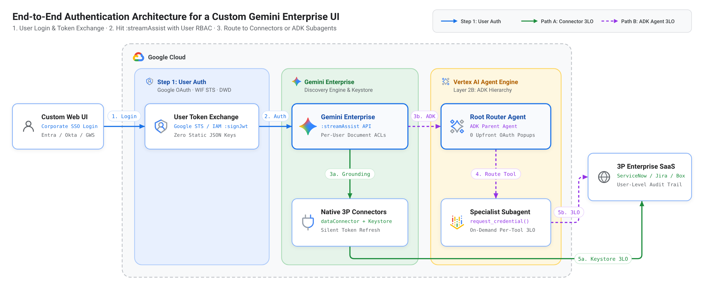
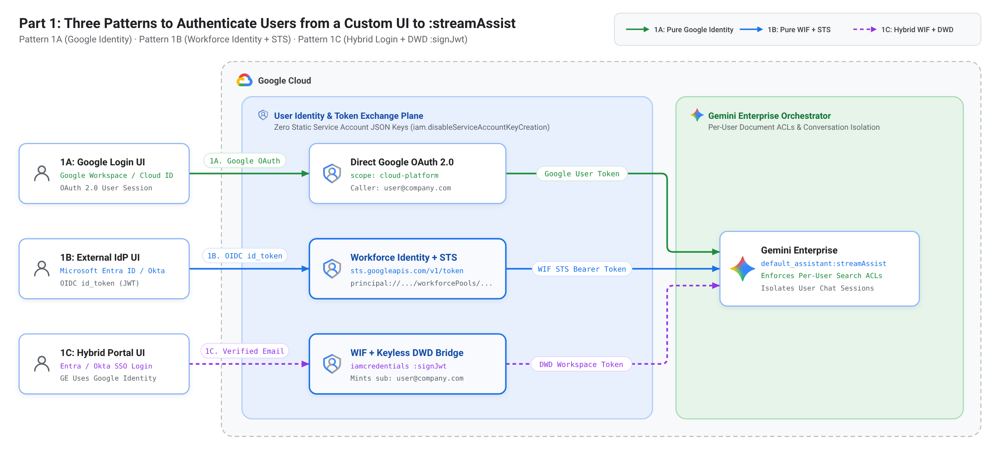
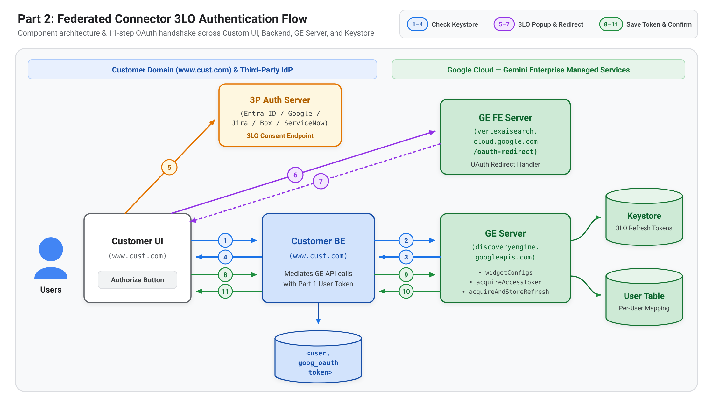
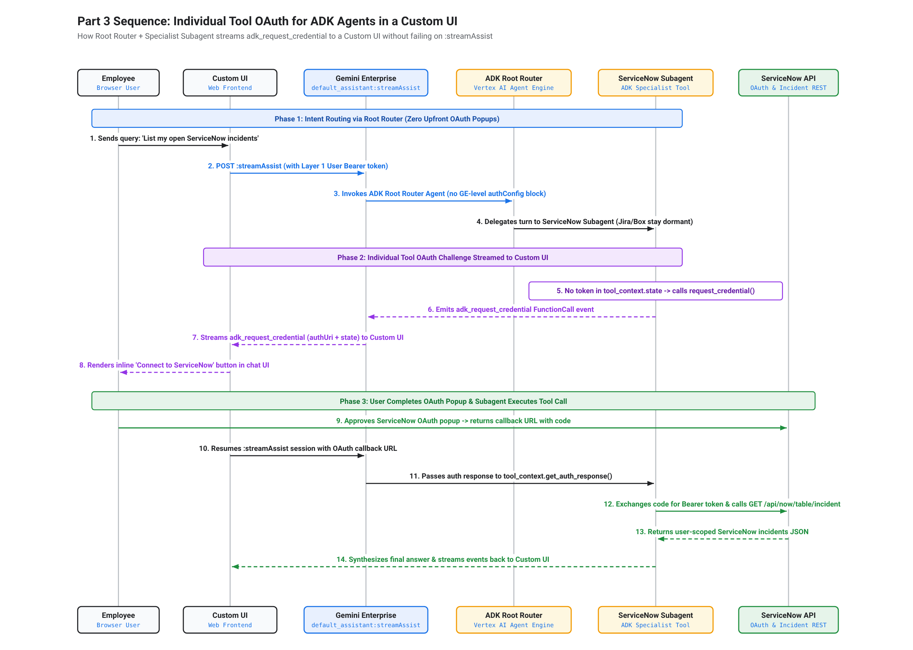

# How to handle user, connector, and agent auth in Gemini Enterprise with a custom UI

*Authentication patterns for calling `:streamAssist`, Federated Connectors, and custom ADK agents from your own web application while preserving per-user access controls.*

---

## Blog Request Metadata (Google for Developers Template)

- **Guidelines:** [go/gds-social-request-guidelines](http://go/gds-social-request-guidelines)
- **Submission Form:** [go/gds-request](http://goto.google.com/gds-request) (Submit at least 7 days prior to publication)

### Section 1: Approvals

| Role | Name | Approval (LGTM) |
| :--- | :--- | :--- |
| **Author** | Neeraj Agrawal (`agrawalneeraj@google.com`) | LGTM |
| **Legal** | Self-certified / [go/whichlawyer](http://goto.google.com/whichlawyer) | Pending |
| **Marketing** | Google Cloud AI Developer Relations | Pending |
| **PR - [PA]** | Cloud AI ([go/dev-pr-review](http://goto.google.com/dev-pr-review)) | Pending |

### Section 2: General Information and Metadata

| Field | Value |
| :--- | :--- |
| **Publish Date** | TBD (7 to 10 business days post-submission) |
| **Blog Title Options (<85 chars)** | 1. `How to handle user, connector, and agent auth in Gemini Enterprise with a custom UI` (83 chars)<br>2. `Connecting your custom enterprise UI to Gemini Enterprise with user-level RBAC` (78 chars)<br>3. `Authentication patterns for building a custom UI on Gemini Enterprise` (69 chars) |
| **Author and Job Title** | Neeraj Agrawal, Forward Deployed Engineer, Google Cloud |
| **Product Stack** | Cloud |
| **Developer focus** | Learn / Explore |
| **Content type** | Deep-dive architecture and reference blueprint |
| **SEO Labels / keywords** | Primary Tag: `Resources` · Keywords: `Gemini Enterprise`, `streamAssist`, `Federated Connectors`, `Agent Development Kit`, `ADK`, `Workforce Identity Federation`, `RBAC` |
| **Link to drive containing illustrations** | [https://drive.google.com/drive/folders/1ochmWXmEK0NFAg7FheWW21p4Rh7knlI8](https://drive.google.com/drive/folders/1ochmWXmEK0NFAg7FheWW21p4Rh7knlI8) (`Blog_Illustrations_Assets` subfolder with all 4 PNG + 4 SVG diagrams) |
| **Alt text or captions for all images** | **Figure 1 Alt Text:** End-to-end authentication architecture diagram for a custom enterprise UI calling Gemini Enterprise (`:streamAssist`), showing Step 1 (user authentication via Google Identity, Workforce Identity Federation, or Hybrid Keyless DWD), Step 2 (routing through `:streamAssist` with user RBAC), and branching into Path A (Federated Connectors backed by Gemini Enterprise's managed Keystore) and Path B (custom ADK agents on Vertex AI Agent Engine with per-tool OAuth).<br><br>**Figure 2 Alt Text:** Architecture diagram comparing three user authentication patterns from a custom UI to Gemini Enterprise `:streamAssist`: Pattern 1A (Pure Google Identity OAuth 2.0), Pattern 1B (Workforce Identity Federation with Entra ID or Okta via Google STS), and Pattern 1C (Hybrid Entra ID or Okta login bridged to Google Identity via Keyless Domain-Wide Delegation `:signJwt`), alongside a callout explaining why Workload Identity Federation (`workloadIdentityPools`) is machine-only and breaks per-agent RBAC.<br><br>**Figure 3 Alt Text:** Vertical sequence diagram with five lifelines (Employee, Custom Web UI, App Backend, Discovery Engine `dataConnector` + `Keystore`, and 3P OAuth Server) illustrating the 9-step Federated Connector 3LO flow: checking `GET dataConnector:acquireAccessToken`, opening the consent popup via `vertexaisearch.cloud.google.com/oauth-redirect` (`window.opener.postMessage`), and storing the refresh token via `POST dataConnector:acquireAndStoreRefreshToken`.<br><br>**Figure 4 Alt Text:** Vertical sequence diagram with five lifelines (Custom Web UI, Gemini Enterprise `:streamAssist`, ADK Root Router Agent, ADK Specialist Subagent, and 3P OAuth & API Server) illustrating the 10-step individual tool OAuth flow: routing general queries without upfront popups, emitting `adk_request_credential` when a protected tool is called, completing the browser OAuth popup, and resuming the subagent tool via `tool_context.get_auth_response()`. |
| **Permalink** | *https://developers.googleblog.com/en/* (To be completed by Blog Production Team) |
| **Meta description** | Learn how to handle user, Federated Connector, and custom ADK agent authentication when connecting a custom enterprise UI to Gemini Enterprise (`:streamAssist`). |

---

## Section 3: Blog Post

When you use the out-of-the-box **[Gemini Enterprise](https://cloud.google.com/gemini/enterprise/docs/overview)** web application, identity and role-based access control (RBAC) work automatically. Employees sign in with corporate single sign-on (SSO), search results respect their personal document permissions, and the first time someone queries a live **Federated Connector** (like Jira, ServiceNow, or Confluence) or a custom **[Agent Development Kit (ADK)](https://google.github.io/adk-docs/)** agent, the web app automatically displays a "Connect" button to link their third-party account.

In practice, however, many enterprises want **their own UI**. They want to bring Gemini into their company intranet, an internal engineering portal, a customer support workbench, or a custom chat sidebar where employees already work.

To build your own UI on top of Gemini Enterprise, your application calls the **[`:streamAssist` REST API](https://cloud.google.com/generative-ai-app-builder/docs/reference/rest/v1alpha/projects.locations.collections.engines.assistants/streamAssist)** directly.

Here is the catch: **the moment you build a custom UI and call `:streamAssist`, all the authentication and RBAC flows that the built-in Gemini Enterprise web app handled behind the scenes become your responsibility.**

Specifically, your custom UI and backend must handle three authentication layers:

1. **Passing the signed-in employee's identity to `:streamAssist` (for document and agent RBAC):** In early prototypes, teams often call `:streamAssist` using a shared backend service account. In production, that breaks RBAC completely: Gemini Enterprise sees every query as coming from the same machine identity rather than the logged-in employee. Document access control lists (ACLs) stop working, chat history is no longer isolated per user, and you cannot restrict low-code or custom agents to specific teams. Your custom UI needs a pattern to pass the real user's identity across **Google Identity**, **[Workforce Identity Federation](https://cloud.google.com/iam/docs/workforce-identity-federation) (Microsoft Entra ID or Okta)**, or a **hybrid combination of both**.
2. **Authenticating Federated Connectors through your custom UI:** Real-time Federated Connectors in Gemini Enterprise use 3-Legged OAuth (3LO) so they only retrieve Jira issues, ServiceNow incidents, or Confluence pages that the signed-in employee is allowed to see. Because your custom UI does not have Gemini Enterprise's built-in "Connect" button, `:streamAssist` will silently skip an unlinked connector unless your UI checks for a valid token, triggers the login popup, and saves the refresh token into Gemini Enterprise's managed **Keystore**.
3. **Handling third-party OAuth for custom ADK agents in your custom UI:** When you register a high-code **ADK agent on [Vertex AI Agent Engine](https://cloud.google.com/vertex-ai/generative-ai/docs/agent-engine/overview)** and attach OAuth (`authorizationConfig`) at the Gemini Enterprise level, Gemini Enterprise requires its own built-in web UI to render the login popup. When you call `:streamAssist` from your **custom UI**, that built-in popup is not available and the `:streamAssist` call fails (plus, attaching multiple OAuth configs at the root agent level blocks the entire agent upfront, even if the user only asked *"What is our company holiday policy?"*). Therefore, you need **individual, tool-level authentication inside the ADK agent** that streams the login request back through `:streamAssist` so your custom UI can display the login prompt on demand.

This post walks through a clean reference architecture, sequence diagrams, and runnable code to solve all three layers:

* **Part 1 (User login to `:streamAssist`):** Keyless user authentication from your custom UI across Google Identity, Workforce Identity Federation, and Hybrid SSO setups.
* **Part 2 (Federated Connector auth in your UI):** How to wire up the two-step OAuth handshake ([`dataConnector:acquireAccessToken`](https://cloud.google.com/generative-ai-app-builder/docs/reference/rest/v1alpha/projects.locations.collections.dataConnector/acquireAccessToken) and [`dataConnector:acquireAndStoreRefreshToken`](https://cloud.google.com/generative-ai-app-builder/docs/reference/rest/v1alpha/projects.locations.collections.dataConnector/acquireAndStoreRefreshToken)) so users can connect Jira, ServiceNow, or Confluence directly from your custom UI.
* **Part 3 (Individual tool auth for custom ADK agents):** Using a Root Router Agent and specialist subagents ([`tool_context.request_credential`](https://google.github.io/adk-docs/tools/authentication/)) so third-party login prompts appear in your custom UI on demand without failing on `:streamAssist`.



**Figure 1: End-to-end authentication architecture across user login (`:streamAssist`), Federated Connectors (`Keystore`), and custom ADK agents (`Vertex AI Agent Engine`).**

---

## Part 1: Three patterns to authenticate users from your custom UI to `:streamAssist`

To enforce per-user RBAC on enterprise documents and agents, Gemini Enterprise needs to know which human employee is calling `:streamAssist`.

In enterprise environments, customer architectures fall into three user authentication patterns (plus one machine-to-machine pattern for background jobs):

| Pattern | How Users Sign Into Your Custom UI | How Gemini Enterprise Is Configured | Where the Token Request Hits | Identity Seen by Gemini Enterprise | Enforces Per-User RBAC & ACLs? |
| :--- | :--- | :--- | :--- | :--- | :--- |
| **Pattern 1A: Pure Google Identity** | Google Workspace / Cloud Identity | Google Identity | Google OAuth 2.0 (`oauth2.googleapis.com`) | `user@company.com` | **Yes** |
| **Pattern 1B: Pure Workforce Identity (WIF)** | Microsoft Entra ID, Okta, or Ping | Workforce Identity (WIF) | [Google Security Token Service (`sts.googleapis.com/v1/token`)](https://cloud.google.com/iam/docs/reference/sts/rest/v1/TopLevel/token) | `principal://.../workforcePools/.../subject/user@company.com` | **Yes** |
| **Pattern 1C: Hybrid (Entra/Okta UI + Google Identity GE)** | Microsoft Entra ID or Okta | Google Identity (or Google Workspace connectors) | [IAM Credentials API (`:signJwt`)](https://cloud.google.com/iam/docs/reference/credentials/rest/v1/projects.serviceAccounts/signJwt) then `oauth2.googleapis.com/token` | `user@company.com` | **Yes** |
| **Machine-Only: Workload Identity Federation** | Backend server (Azure, AWS, GKE) | Either mode (non-personalized bot) | Google STS (`workloadIdentityPools`) | `principal://.../workloadIdentityPools/...` (or shared SA) | **No** (Requires sharing agents with "All users") |



**Figure 2: Comparing Patterns 1A, 1B, and 1C for authenticating users from a custom UI to `:streamAssist`, plus why Workload Identity Federation is machine-only.**

> **Why Workload Identity Federation (`workloadIdentityPools`) breaks RBAC for Low-Code and Custom Agents:**
> Teams sometimes try to use **[Workload Identity Federation](https://cloud.google.com/iam/docs/workload-identity-federation)** (`workloadIdentityPools`) or a shared Service Account to connect their backend to Gemini Enterprise. However, Workload Identity Federation authenticates a *machine*, not a human employee. Inside Gemini Enterprise, [per-agent `User permissions`](https://cloud.google.com/gemini/enterprise/docs/share-custom-agents) only accept human directory identities (`user@company.com` emails or `workforcePools` principals). You cannot add a `workloadIdentityPools` principal to a restricted agent's access list. As a result, if you use a machine token, you are forced to share your low-code and no-code agents with **"All users"** in the app, and every employee using your UI shares the exact same permissions. For any user-facing UI, always use **Pattern 1A**, **1B**, or **1C**.

### Pattern 1A: Pure Google Identity (`Google Login UI` to `:streamAssist`)

When your employees sign in with Google Workspace or Cloud Identity and your Gemini Enterprise engine is set to **Google Identity**, the request flow has zero extra hops:

1. Your **Custom Web UI** signs the employee in using [Google Identity Services (OAuth 2.0)](https://developers.google.com/identity/oauth2/web/guides/overview) and requests the `https://www.googleapis.com/auth/cloud-platform` scope.
2. Google returns a standard user `access_token` scoped to `user@company.com`.
3. Your app sends that token directly to `:streamAssist` in the `Authorization: Bearer` header.

### Pattern 1B: Pure Workforce Identity Federation (`External IdP UI` to `Google STS` to `:streamAssist`)

When your employees sign into your custom UI with **Microsoft Entra ID** or **Okta** and your Gemini Enterprise environment uses **[Workforce Identity Federation (WIF)](https://cloud.google.com/iam/docs/workforce-identity-federation)**, you reuse the exact same Workforce Pool that is already connected to Gemini Enterprise:

1. **Register your custom UI on your existing WIF Provider:** Add your custom web app's Entra ID or Okta Client ID to your Google Cloud Workforce Pool OIDC Provider.
2. **Hit Google STS (`sts.googleapis.com/v1/token`):** After the employee signs into your UI and receives an OIDC `id_token`, your app sends that `id_token` to [Google Security Token Service (`https://sts.googleapis.com/v1/token`)](https://cloud.google.com/iam/docs/reference/sts/rest/v1/TopLevel/token), passing your Workforce Pool Provider resource name as the `audience`.
3. **Hit `:streamAssist` with the federated user token:** Google STS returns a short-lived Google federated token representing `principal://iam.googleapis.com/locations/global/workforcePools/<POOL_ID>/subject/<USER>`. Sending this token to `:streamAssist` enforces all of that user's Workforce Pool group permissions and document ACLs.

### Pattern 1C: Hybrid login (`Entra ID / Okta UI` to `Keyless DWD :signJwt` to `:streamAssist`)

Many large enterprises have a split setup: employees log into internal web portals using **Microsoft Entra ID** or **Okta**, but their Gemini Enterprise engine (or their connected Google Drive and Gmail data stores) uses **Google Identity** (`user@company.com`).

In this hybrid scenario, sending a WIF token to a Google-Identity engine fails with a `403` error because Gemini Enterprise expects a Google Workspace user identity. At the same time, security policies (`constraints/iam.disableServiceAccountKeyCreation`) prohibit downloading a service account JSON key to run traditional [Domain-Wide Delegation (DWD)](https://developers.google.com/identity/protocols/oauth2/service-account#delegatingauthority).

You bridge the two without downloaded keys in three hops:

1. **Verify the Entra ID or Okta login on your backend:** The employee signs into your custom UI with Entra ID or Okta and sends their OIDC token to your backend. Your backend verifies the token signature and extracts the user's verified email (`user@company.com`).
2. **Hit the IAM Credentials API (`iamcredentials.googleapis.com/...:signJwt`):** Using `google.auth.iam.Signer`, your backend asks the [IAM Credentials API (`:signJwt`)](https://cloud.google.com/iam/docs/reference/credentials/rest/v1/projects.serviceAccounts/signJwt) to sign a short-lived JWT assertion with `"sub"` set to `user@company.com`—with zero private key files on disk.
3. **Exchange at `oauth2.googleapis.com/token` and hit `:streamAssist`:** `google-auth` exchanges the hardware-signed JWT for a scoped Google Workspace `access_token` representing `user@company.com`, which your backend passes to `:streamAssist`:

```python
from google.auth import default as google_auth_default, iam
from google.auth.transport import requests as google_requests
from google.oauth2 import service_account

def mint_keyless_dwd_user_token(dwd_sa_email: str, user_email: str) -> str:
    auth_req = google_requests.Request()
    source_creds, _ = google_auth_default(scopes=["https://www.googleapis.com/auth/cloud-platform"])
    signer = iam.Signer(auth_req, source_creds, dwd_sa_email)  # Calls IAM :signJwt (no JSON key)
    dwd_creds = service_account.Credentials(
        signer=signer,
        service_account_email=dwd_sa_email,
        token_uri="https://oauth2.googleapis.com/token",
        scopes=["https://www.googleapis.com/auth/cloud-platform"],
        subject=user_email,
    )
    dwd_creds.refresh(auth_req)
    return dwd_creds.token
```

---

## Part 2: Authenticating Federated Connectors through your custom UI

Once your custom UI is calling `:streamAssist` as the signed-in employee, users can query native **Federated Connectors** (such as ServiceNow, Jira, and Confluence) that search live third-party APIs in real time.

Because Federated Connectors enforce user-level permissions in the third-party system, each employee must authorize the connector once using 3-Legged OAuth (3LO). Gemini Enterprise stores those per-user refresh tokens inside its own managed **Keystore**, so you never have to store third-party credentials in your own database.

**Figure 3** shows the vertical sequence across your Custom UI, App Backend, Discovery Engine (`dataConnector` and `Keystore`), and the third-party OAuth server:



**Figure 3: Vertical sequence diagram for authenticating a Gemini Enterprise Federated Connector (`acquireAccessToken`, popup redirect, and `acquireAndStoreRefreshToken`) from a custom UI.**

1. **Phase 1 (Check Keystore or Get `authUri`, Steps 1 to 3):** When the employee sends a query that uses a Federated Connector, your **App Backend** calls [`GET dataConnector:acquireAccessToken`](https://cloud.google.com/generative-ai-app-builder/docs/reference/rest/v1alpha/projects.locations.collections.dataConnector/acquireAccessToken) with the user's Part 1 Bearer token. If the user has authenticated before, Gemini Enterprise refreshes their token from the **Keystore** automatically. If no token exists yet, Discovery Engine returns `authUri` (`needs_oauth`).
2. **Phase 2 (Browser Consent Popup & `postMessage` Relay, Steps 4 to 6):** Your **Custom UI** opens `authUri` in a popup window using `redirect_uri=https://vertexaisearch.cloud.google.com/oauth-redirect`. Once the user approves consent in Jira or ServiceNow, the popup redirects to Google's `oauth-redirect` relay page, which posts the authorization `code` and `state` back to your **Custom UI** via `window.opener.postMessage`.
3. **Phase 3 (Store Refresh Token in Keystore & Execute `:streamAssist`, Steps 7 to 9):** Your frontend sends the `fullRedirectUri` to your **App Backend**, which calls [`POST dataConnector:acquireAndStoreRefreshToken`](https://cloud.google.com/generative-ai-app-builder/docs/reference/rest/v1alpha/projects.locations.collections.dataConnector/acquireAndStoreRefreshToken). Discovery Engine exchanges the code with the third-party OAuth server, locks the refresh token inside the **Keystore**, and streams the grounded `:streamAssist` response back to your UI.

---

## Part 3: Authenticating custom ADK agents with individual tool OAuth in your custom UI

Native Federated Connectors are ideal for federated search and simple actions. When your workflow requires multi-step reasoning, custom Python guardrails, or orchestrating across multiple enterprise APIs, you build a **high-code [ADK agent](https://google.github.io/adk-docs/)**, deploy it on **[Vertex AI Agent Engine](https://cloud.google.com/vertex-ai/generative-ai/docs/agent-engine/overview)**, and register it in Gemini Enterprise.

### Why Gemini Enterprise root-level OAuth fails when calling `:streamAssist` from a custom UI

When you register a custom ADK agent in Gemini Enterprise, you have the option to attach third-party `authorizationConfig` resources directly to the agent registration in Gemini Enterprise.

However, when you call that agent from a **custom UI via `:streamAssist`**, attaching `authorizationConfig` at the Gemini Enterprise level causes two problems:

1. **Calling `:streamAssist` from a custom UI fails:** Gemini Enterprise expects its own built-in web app to catch that agent-level authorization requirement and pop up a login window before invoking the agent. Because your custom UI calls `:streamAssist` over REST, that built-in Gemini Enterprise popup cannot render and the request fails.
2. **Upfront blocking across multiple tools:** Any `authorizationConfig` attached at the root agent level gates the entire agent upfront. If your assistant connects to ServiceNow, Jira, and Box, a user cannot even ask a general HR policy question without being blocked by all three OAuth checks first.

### The solution: Individual per-tool OAuth (`tool_context.request_credential`) rendered in your custom UI

To make custom ADK agents work reliably over `:streamAssist` and prompt the user **only when a specific third-party tool is called**, do not attach `authorizationConfig` at the Gemini Enterprise registration level. Instead, manage OAuth individually inside each ADK tool using [`tool_context.request_credential()`](https://google.github.io/adk-docs/tools/authentication/) and [`tool_context.get_auth_response()`](https://google.github.io/adk-docs/tools/authentication/), as shown in the **Figure 4** sequence diagram:



**Figure 4: Vertical sequence diagram for individual tool OAuth (`adk_request_credential`) in a custom ADK agent invoked from a custom UI via `:streamAssist`.**

```python
from google.adk.tools import ToolContext
import requests

def list_servicenow_incidents(tool_context: ToolContext, auth_config: dict) -> dict:
    # 1. Check if the user has already completed 3LO for this tool
    auth_resp = tool_context.get_auth_response(auth_config)
    access_token = getattr(auth_resp, "access_token", None) if auth_resp else None
    if not access_token:
        # 2. Stream an `adk_request_credential` event back to the Custom UI on demand
        tool_context.request_credential(auth_config)
        return {"status": "PENDING_USER_OAUTH", "message": "Please authorize ServiceNow."}
    # 3. Call the third-party API with the user's 3LO Bearer token
    return requests.get(
        "https://your-instance.service-now.com/api/now/table/incident",
        headers={"Authorization": f"Bearer {access_token}"},
        timeout=20,
    ).json()
```

1. **Phase 1 (Intent Routing via Root Router, Steps 1 to 4):** The employee sends *"List my open ServiceNow incidents"* from your **Custom UI** to `:streamAssist`. Because no `authorizationConfig` is attached at the Gemini Enterprise level, `:streamAssist` invokes the **ADK Root Router Agent** immediately with zero upfront popups, and the Root Router delegates the turn to the **ServiceNow Subagent** (while other tools or subagents stay dormant).
2. **Phase 2 (Individual Tool OAuth Challenge Streamed to Custom UI, Steps 5 to 6):** The **ServiceNow Subagent** checks for a cached token via `tool_context.get_auth_response()`. On first use, it calls `tool_context.request_credential()`, which streams an `adk_request_credential` event back through `:streamAssist` so your **Custom UI** can render an inline **"Connect to ServiceNow"** button right inside the chat thread.
3. **Phase 3 (User Completes OAuth Popup & Subagent Executes Tool Call, Steps 7 to 10):** The employee clicks the inline button, approves the ServiceNow OAuth popup, and your **Custom UI** sends the callback response back to the `:streamAssist` session. The **ServiceNow Subagent** retrieves the token via `tool_context.get_auth_response()`, calls `GET /api/now/table/incident`, and streams the final answer back to your **Custom UI**.

---

## Summary: Choosing the right authentication pattern for your custom UI

Use this quick reference table to match your enterprise architecture to the right pattern:

| What You Are Connecting to Your Custom UI | Recommended Pattern | Where the Auth Request Hits |
| :--- | :--- | :--- |
| **User Login: Google Workspace + `:streamAssist`** | **Pattern 1A:** Direct Google OAuth 2.0 | Browser gets Google OAuth token (`cloud-platform` scope) and sends it directly to `:streamAssist`. |
| **User Login: Entra ID / Okta + WIF Gemini Enterprise** | **Pattern 1B:** Workforce Identity Federation + Google STS | App exchanges Entra/Okta `id_token` at `sts.googleapis.com/v1/token` and sends the STS token to `:streamAssist`. |
| **User Login: Entra ID / Okta UI + Google Identity GE** | **Pattern 1C:** Hybrid Login + Keyless DWD | Backend verifies Entra/Okta login, signs a JWT via `iamcredentials :signJwt`, exchanges it at `oauth2.googleapis.com/token`, and calls `:streamAssist`. |
| **Out-of-the-Box Federated Connectors (Jira, ServiceNow, Confluence)** | **Part 2:** Discovery Engine `dataConnector` + Managed **Keystore** | App checks `dataConnector:acquireAccessToken`, runs the popup via `vertexaisearch.cloud.google.com/oauth-redirect`, and saves the refresh token via `:acquireAndStoreRefreshToken`. |
| **Custom High-Code ADK Agents with Multiple 3P Tools** | **Part 3:** Root Router Agent + Specialist Subagent On-Demand 3LO | Root Router runs with zero upfront auth; subagent calls `tool_context.request_credential()` on demand only when its tool is invoked. |

---

## Explore the runnable code blueprint

We have packaged all three authentication layers into a clean, modular reference repository with standalone Python scripts and `curl` commands that you can run directly against your Gemini Enterprise engine. Check out the **[`gemini-enterprise-custom-ui-auth` GitHub repository](https://github.com/MagnIeeT/gemini-enterprise-custom-ui-auth)**, which includes:

* **Part 1 — User Auth to `:streamAssist` ([`01_user_auth_streamassist/`](https://github.com/MagnIeeT/gemini-enterprise-custom-ui-auth/tree/main/01_user_auth_streamassist)):** Standalone scripts and `curl` commands for **Pattern 1A (`pattern_a_google_identity.py`)**, **Pattern 1B (`pattern_b_workforce_sts.py`)**, and **Pattern 1C (`pattern_c_hybrid_keyless_dwd.py`)**.
* **Part 2 — Federated Connector 3LO Flow ([`02_federated_connector_oauth/`](https://github.com/MagnIeeT/gemini-enterprise-custom-ui-auth/tree/main/02_federated_connector_oauth)):** End-to-end helper (`connector_oauth_flow.py`) and frontend `window.addEventListener("message")` snippet for [`dataConnector:acquireAccessToken`](https://cloud.google.com/generative-ai-app-builder/docs/reference/rest/v1alpha/projects.locations.collections.dataConnector/acquireAccessToken) and [`dataConnector:acquireAndStoreRefreshToken`](https://cloud.google.com/generative-ai-app-builder/docs/reference/rest/v1alpha/projects.locations.collections.dataConnector/acquireAndStoreRefreshToken).
* **Part 3 — Custom ADK Agent On-Demand OAuth ([`03_adk_agent_oauth/`](https://github.com/MagnIeeT/gemini-enterprise-custom-ui-auth/tree/main/03_adk_agent_oauth)):** Client script (`query_registered_agent.py`) to query a registered ADK agent via `:streamAssist` (`agentsSpec.agentSpecs`) plus a reference Root Router + Specialist Subagent implementation (`sample_adk_subagent_oauth.py`) using `tool_context.request_credential()`.

---

## Section 4: Social Copy

| Platform | Copy |
| :--- | :--- |
| **Twitter / X** | Building a custom enterprise UI on top of Gemini Enterprise (`:streamAssist`)? Learn how to handle user SSO, Federated Connector 3LO, and on-demand ADK agent tool auth while preserving per-user RBAC: [Link] |
| **LinkedIn** | When you use the out-of-the-box Gemini Enterprise web app, user sign-in, document RBAC, Federated Connector login buttons (for Jira, ServiceNow, Confluence), and custom agent OAuth prompts happen automatically.<br><br>But when enterprises build their own custom UI on top of the `:streamAssist` API, all three layers of authentication become your responsibility:<br>1. Authenticating employees into `:streamAssist` with full RBAC across Google Identity, Workforce Identity Federation (Entra ID / Okta), or Hybrid Keyless DWD<br>2. Authenticating Federated Connectors through your custom UI using Gemini Enterprise's managed Keystore<br>3. Triggering 3-Legged OAuth on demand for custom ADK agents on Vertex AI Agent Engine without failing on `:streamAssist`<br><br>In our new Google for Developers guide, we walk through the complete architecture, sequence diagrams, and open-source companion repo (`gemini-enterprise-custom-ui-auth`): [Link] |
| **Social Asset** | `fig1-end-to-end-identity-architecture.png` (in linked Drive folder `Blog_Illustrations_Assets`) |
