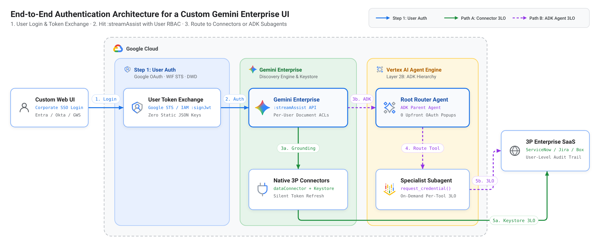
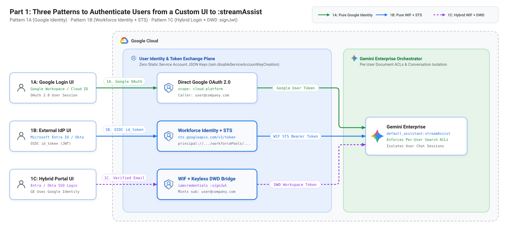
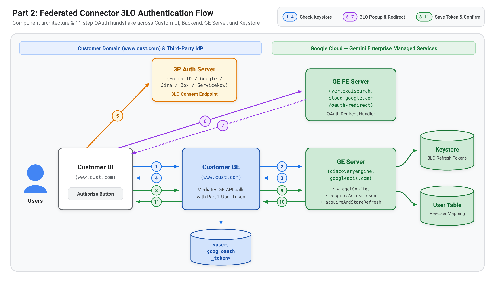
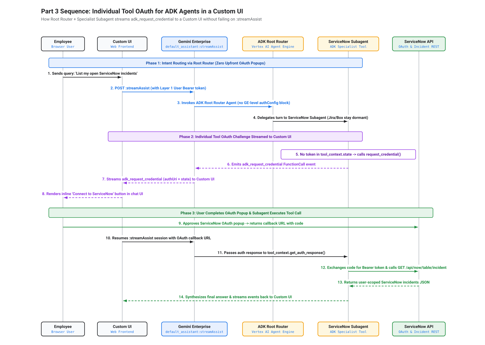

# How to Handle User, Connector, and Agent Auth in Gemini Enterprise with a Custom UI

Companion code and CLI reference for authenticating a custom enterprise web UI against the Gemini Enterprise **`:streamAssist`** REST API across all three authentication layers:

1. **Part 1 (`01_user_auth_streamassist/`): Authenticating to `:streamAssist`**
   - **Pattern 1A:** Pure Google Identity (`Google Login UI` -> `:streamAssist`)
   - **Pattern 1B:** Pure Workforce Identity Federation (`External IdP UI` -> `Google STS` -> `:streamAssist`)
   - **Pattern 1C:** Workload Identity Federation for Bots / Backend Services (`Workload JWT` -> `Google STS` -> `Service Account Impersonation` -> `:streamAssist`)
2. **Part 2 (`02_federated_connector_oauth/`): Authenticating Federated Connectors through a custom UI**
   - Checking and storing per-user 3-legged OAuth (3LO) tokens in Gemini Enterprise's managed `Keystore` via `dataConnector:acquireAccessToken` and `dataConnector:acquireAndStoreRefreshToken`.
3. **Part 3 (`03_adk_agent_oauth/`): Authenticating custom ADK agents with individual tool OAuth**
   - Calling a registered high-code ADK agent via `:streamAssist` (`agentsSpec.agentSpecs`) and triggering third-party OAuth on demand per tool (`request_credential`) instead of blocking the entire agent at registration time.



---

## Repository Structure

```text
gemini-enterprise-custom-ui-auth/
├── .env.example                    # Template for project, engine, WIF, Workload Identity, connector, and agent IDs
├── requirements.txt                # Minimal Python dependencies
├── README.md                       # Step-by-step Python & curl commands
├── docs/diagrams/                  # Architecture & sequence diagrams (PNG + SVG)
├── 01_user_auth_streamassist/
│   ├── pattern_a_google_identity.py
│   ├── pattern_b_workforce_sts.py
│   └── pattern_c_workload_identity.py
├── 02_federated_connector_oauth/
│   └── connector_oauth_flow.py
└── 03_adk_agent_oauth/
    ├── query_registered_agent.py
    └── sample_adk_subagent_oauth.py
```

---

## Prerequisites & Setup

1. **Existing Gemini Enterprise Setup:**
   - A Gemini Enterprise Engine (`GE_GOOGLE_ID_ENGINE_ID` or `GE_WIF_ENGINE_ID`) configured in your Google Cloud project.
   - Your identity foundation already configured (Google Identity, a Workforce Identity Pool for human users, or a Workload Identity Pool for non-human bots/workloads).
   - **User IAM Role & Gemini Enterprise License (Required for All Patterns):**
     In production, every end user (or user group) calling `:streamAssist` must have **both**:
     1. **Cloud IAM Role:** **Discovery Engine User** (`roles/discoveryengine.user`) granted in **GCP Console $\rightarrow$ IAM & Admin $\rightarrow$ IAM** (provides the `discoveryengine.assistants.assist` permission).
     2. **Gemini Enterprise License:** An active seat assigned in **Gemini Enterprise $\rightarrow$ Settings $\rightarrow$ License** (assigned directly to the user/group or via **Automatic license assignment** on first access).
   - *(Optional for Part 2)* A Federated Connector configured on a Discovery Engine collection.
   - *(Optional for Part 3)* A custom high-code ADK agent deployed to Vertex AI Agent Engine and registered in Gemini Enterprise (`GE_GOOGLE_ID_AGENT_ID` or `GE_WIF_AGENT_ID`).

2. **Install Dependencies & Configure `.env`:**

```bash
pip install -r requirements.txt
cp .env.example .env
# Edit .env with your GCP_PROJECT_ID, Engine IDs, and Agent IDs
set -a && source .env && set +a
```

---

## Part 1: Three Patterns to Authenticate Users to `:streamAssist`



### Pattern 1A: Pure Google Identity (`pattern_a_google_identity.py`)

Use when both your custom UI and Gemini Enterprise use **Google Identity** (Google Workspace or Cloud Identity).

#### Prerequisites for Custom UI Sign-In (`--browser-login`)
When building a custom UI (outside `vertexaisearch.cloud.google.com`), your web app needs a **Google OAuth 2.0 Client ID** to sign the user in and obtain a user-scoped access token (`ya29...`):
1. In **GCP Console $\rightarrow$ APIs & Services $\rightarrow$ Credentials $\rightarrow$ + Create Credentials $\rightarrow$ OAuth client ID**:
   - **Application type:** `Web application`
   - **Authorized redirect URIs:** `http://localhost:8085/callback` (for local testing) or your production Custom UI callback URL
   - **OAuth Scope:** `openid email profile https://www.googleapis.com/auth/cloud-platform`
2. Set `GOOGLE_OAUTH_CLIENT_ID` and `GOOGLE_OAUTH_CLIENT_SECRET` in `.env`.
3. **IAM & License:** Ensure the signed-in Google user (or Google Group) has the **Discovery Engine User** (`roles/discoveryengine.user`) IAM role on the project **and** an active **Gemini Enterprise license** assigned in **Gemini Enterprise $\rightarrow$ Settings $\rightarrow$ License**.

**Run with Python:**
```bash
# Option 1: Interactive "Sign in with Google" browser OAuth 2.0 flow (real Custom UI flow)
python 01_user_auth_streamassist/pattern_a_google_identity.py \
  --browser-login \
  --query "What are our Grid Operations SLA policies?"

# Option 2: Quick CLI test using gcloud user credentials
python 01_user_auth_streamassist/pattern_a_google_identity.py \
  --query "What are our Grid Operations SLA policies?"

# Option 3: Route the query directly to a registered ADK agent (--agent-id)
python 01_user_auth_streamassist/pattern_a_google_identity.py \
  --agent-id "$GE_GOOGLE_ID_AGENT_ID" \
  --query "What is our grid operations SLA policy?"
```

**Equivalent `curl` command:**
```bash
curl -s -X POST \
  -H "Authorization: Bearer $(gcloud auth print-access-token)" \
  -H "Content-Type: application/json" \
  -H "X-Goog-User-Project: ${GCP_PROJECT_ID}" \
  "https://discoveryengine.googleapis.com/v1alpha/projects/${GCP_PROJECT_ID}/locations/${GE_GOOGLE_ID_LOCATION}/collections/default_collection/engines/${GE_GOOGLE_ID_ENGINE_ID}/assistants/default_assistant:streamAssist" \
  -d "{
    \"query\": {\"text\": \"${QUERY}\"}
  }"
```

---

### Pattern 1B: Pure Workforce Identity Federation (`pattern_b_workforce_sts.py`)

Use when both your custom UI and Gemini Enterprise use an **external IdP** (Okta, Microsoft Entra ID, Ping Identity) mapped to a Google Cloud **Workforce Identity Pool** (`workforcePools`).

> **Note:** Always use **Workforce Identity Federation (`workforcePools`)** for human users—not Workload Identity Federation (`workloadIdentityPools`). Gemini Enterprise Agent `User permissions` only accept Google Identity or `workforcePools` principals.

#### Prerequisites
1. **External IdP App Registration (e.g., Microsoft Entra ID):**
   - Register an OIDC application in your IdP (matching the `clientId` configured on your Workforce Identity Pool OIDC provider).
   - Add `http://localhost:8000` (or your custom UI origin) under **Authentication $\rightarrow$ Single-page application (SPA)** redirect URIs.
   - Set `ENTRA_TENANT_ID` and `ENTRA_CLIENT_ID` in `.env`.
2. **IAM Role:** Grant the **Discovery Engine User** (`roles/discoveryengine.user`) or **Gemini Enterprise User** IAM role to your Workforce Pool user (`principal://iam.googleapis.com/locations/global/workforcePools/${WIF_POOL_ID}/subject/${USER_SUBJECT}`) or all pool users (`principalSet://iam.googleapis.com/locations/global/workforcePools/${WIF_POOL_ID}/*`).
3. **Gemini Enterprise License:** Assign a Gemini Enterprise license to the federated user/group (or enable **Automatic license assignment**) in **Gemini Enterprise $\rightarrow$ Settings $\rightarrow$ License**.

**Run with Python:**
```bash
# Option 1: Interactive "Sign in with Microsoft Entra ID" browser login (PKCE -> STS -> :streamAssist)
python 01_user_auth_streamassist/pattern_b_workforce_sts.py \
  --browser-login \
  --query "What are our Grid Operations SLA policies?"

# Option 2: Pass an existing external IdP OIDC JWT directly
python 01_user_auth_streamassist/pattern_b_workforce_sts.py \
  --idp-token "<ENTRA_OR_OKTA_JWT>" \
  --query "What are our Grid Operations SLA policies?"
```

**Equivalent `curl` commands (Step 1: STS Exchange -> Step 2: `:streamAssist`):**
```bash
# 1. Exchange the external IdP OIDC token at Google Security Token Service (STS)
STS_TOKEN=$(curl -s -X POST "https://sts.googleapis.com/v1/token" \
  -H "Content-Type: application/json" \
  -d "{
    \"audience\": \"//iam.googleapis.com/locations/global/workforcePools/${WIF_POOL_ID}/providers/${WIF_PROVIDER_ID}\",
    \"grantType\": \"urn:ietf:params:oauth:grant-type:token-exchange\",
    \"requestedTokenType\": \"urn:ietf:params:oauth:token-type:access_token\",
    \"scope\": \"https://www.googleapis.com/auth/cloud-platform\",
    \"subjectTokenType\": \"urn:ietf:params:oauth:token-type:id_token\",
    \"subjectToken\": \"${EXTERNAL_IDP_TOKEN}\"
  }" | python3 -c "import sys,json; print(json.load(sys.stdin)['access_token'])")

# 2. Call :streamAssist using the federated STS access token
curl -s -X POST \
  -H "Authorization: Bearer ${STS_TOKEN}" \
  -H "Content-Type: application/json" \
  -H "X-Goog-User-Project: ${GCP_PROJECT_ID}" \
  "https://${GE_WIF_LOCATION}-discoveryengine.googleapis.com/v1alpha/projects/${GCP_PROJECT_ID}/locations/${GE_WIF_LOCATION}/collections/default_collection/engines/${GE_WIF_ENGINE_ID}/assistants/default_assistant:streamAssist" \
  -d "{
    \"query\": {\"text\": \"${QUERY}\"}
  }"
```

---

### Pattern 1C: Direct Workload Identity Federation (`pattern_c_workload_identity.py`)

Use when a **non-human backend service, microservice, or bot** needs to call `:streamAssist` using a project-scoped **Workload Identity Pool** (`workloadIdentityPools`) directly via Google STS (**zero Service Account required**).

> **Important (Workforce vs. Workload Identity):**
> - **Human Users $\rightarrow$ Use Pattern 1A (Google Identity) or Pattern 1B (`workforcePools`):** Required for per-user document ACLs, Gemini Enterprise user licenses, and 3LO connectors/agents.
> - **Bots / Backend Services $\rightarrow$ Use Pattern 1C (`workloadIdentityPools`):** Used for machine-to-machine or bot workloads where per-user 3LO is not required.

#### Prerequisites
1. **Workload Identity Pool & Provider (`workloadIdentityPools`):**
   - Configure a project-scoped Workload Identity Pool (`WORKLOAD_POOL_ID`) and OIDC provider (`WORKLOAD_PROVIDER_ID`) in **IAM & Admin $\rightarrow$ Workload Identity Federation**.
2. **Direct IAM Role (No Service Account Needed):**
   - Grant the **Discovery Engine User** (`roles/discoveryengine.user`) IAM role directly to your Workload Identity Pool principal (`principalSet://iam.googleapis.com/projects/${GCP_PROJECT_NUMBER}/locations/global/workloadIdentityPools/${WORKLOAD_POOL_ID}/*`).

**Run with Python:**
```bash
python 01_user_auth_streamassist/pattern_c_workload_identity.py \
  --query "What are our Grid Operations SLA policies?"
```

---

## Part 2: Authenticating Federated Connectors through a Custom UI



When your custom UI queries a Federated or Action Connector (SharePoint, Jira, Confluence, ServiceNow, Salesforce, Google Drive), Gemini Enterprise uses its managed **Keystore** to store and mint per-user 3-legged OAuth (3LO) tokens:

1. **List Connectors & Check Authorization Status (`GET .../widgetConfigs/default_search_widget_config` + `POST .../dataConnector:acquireAccessToken`):** Returns `collectionComponents[]` for the engine, each connector's `connectorAuthState.authState`, and the 3LO `authorizationUri` if the user has not authorized the connector yet.
2. **Open 3LO Consent Popup (`https://vertexaisearch.cloud.google.com/oauth-redirect`):** The user signs in to the 3P Auth Server and grants consent; Google's redirect page returns `code` and `state`.
3. **Exchange Code & Store Refresh Token in GE Keystore (`POST .../dataConnector:acquireAndStoreRefreshToken`):** Your backend passes `fullRedirectUri` to Gemini Enterprise, which exchanges the code and saves the `refresh_token` and `access_token` in its managed **Keystore**.
4. **Query `:streamAssist` (`POST .../assistants/default_assistant:streamAssist`):** Subsequent `:streamAssist` queries automatically retrieve live results from the authorized connector using the token in the Keystore.

### Step 1: List All Connectors on the Engine & Check Keystore Auth Status
```bash
# Using Google Identity (or pass --auth-mode wif --browser-login for Workforce Identity)
python 02_federated_connector_oauth/connector_oauth_flow.py --step list
```

**Equivalent `curl` commands (List Engine Connectors + Check Keystore Token):**
```bash
# 1a. List connectors attached to the engine and get authorizationUri if unauthorized
curl -s -X GET \
  -H "Authorization: Bearer $(gcloud auth print-access-token)" \
  -H "X-Goog-User-Project: ${GCP_PROJECT_ID}" \
  "https://discoveryengine.googleapis.com/v1alpha/projects/${GCP_PROJECT_ID}/locations/${GE_GOOGLE_ID_LOCATION}/collections/default_collection/engines/${GE_GOOGLE_ID_ENGINE_ID}/widgetConfigs/default_search_widget_config"

# 1b. Check if a live access token can be minted from the GE Keystore for a specific connector
curl -s -X POST \
  -H "Authorization: Bearer $(gcloud auth print-access-token)" \
  -H "Content-Type: application/json" \
  -H "X-Goog-User-Project: ${GCP_PROJECT_ID}" \
  "https://discoveryengine.googleapis.com/v1alpha/projects/${GCP_PROJECT_ID}/locations/${CONNECTOR_LOCATION}/collections/${CONNECTOR_COLLECTION_ID}/dataConnector:acquireAccessToken" \
  -d "{}"
```

### Step 2: Check a Specific Connector & Open the 3LO Popup
```bash
python 02_federated_connector_oauth/connector_oauth_flow.py \
  --step check \
  --collection-id "${CONNECTOR_COLLECTION_ID}"
```

In a web frontend, open `authorizationUri` in a popup and listen for `window.opener.postMessage` from `https://vertexaisearch.cloud.google.com/oauth-redirect`:

```javascript
// In your custom frontend UI:
const popup = window.open(authorizationUri, "ConnectorOAuth", "width=520,height=680");

window.addEventListener("message", async (event) => {
  if (event.origin !== "https://vertexaisearch.cloud.google.com") return;
  const { code, state } = event.data;
  if (code) {
    // Send code & state to your backend to call :acquireAndStoreRefreshToken
    await fetch("/api/connector/store-token", {
      method: "POST",
      body: JSON.stringify({ code, state }),
    });
  }
});
```

### Step 3: Exchange Code & Store Refresh Token in Gemini Enterprise `Keystore`
```bash
# Pass the full redirect URL from the browser (or --code "<CODE>" --state "<STATE>")
python 02_federated_connector_oauth/connector_oauth_flow.py \
  --step store \
  --collection-id "${CONNECTOR_COLLECTION_ID}" \
  --full-redirect-uri "https://vertexaisearch.cloud.google.com/oauth-redirect?code=...&state=..."
```

### Step 4: Run a `:streamAssist` Query Using the Authorized Connector
```bash
python 02_federated_connector_oauth/connector_oauth_flow.py \
  --step query \
  --query "Summarize my latest documents in SharePoint"
```

---

## Part 3: Authenticating Custom ADK Agents with Individual Tool OAuth



Attaching `authorizationConfig` at the top-level Gemini Enterprise agent registration requires Gemini Enterprise's built-in web UI to render the OAuth popup, causing `:streamAssist` calls from a custom UI to fail. Instead, register the ADK agent **without** top-level `authorizationConfig` and handle OAuth inside the individual ADK tool (`03_adk_agent_oauth/sample_adk_subagent_oauth.py`).

### Test 1: Query an Internal Policy Tool on the Registered Agent (No 3LO Required)
```bash
python 03_adk_agent_oauth/query_registered_agent.py \
  --auth-mode google \
  --query "What are our Grid Operations SLA policies?"
```

### Test 2: Query a Protected 3P Tool on the Registered Agent (Triggers On-Demand 3LO Prompt)
```bash
python 03_adk_agent_oauth/query_registered_agent.py \
  --auth-mode google \
  --query "List my open ServiceNow incidents"
```

### Equivalent `curl` Command Targeting a Registered Agent via `:streamAssist`
```bash
curl -s -X POST \
  -H "Authorization: Bearer $(gcloud auth print-access-token)" \
  -H "Content-Type: application/json" \
  -H "X-Goog-User-Project: ${GCP_PROJECT_ID}" \
  "https://discoveryengine.googleapis.com/v1alpha/projects/${GCP_PROJECT_ID}/locations/${GE_GOOGLE_ID_LOCATION}/collections/default_collection/engines/${GE_GOOGLE_ID_ENGINE_ID}/assistants/default_assistant:streamAssist" \
  -d "{
    \"query\": {\"text\": \"List my open ServiceNow incidents\"},
    \"answerGenerationMode\": \"AGENT\",
    \"agentsSpec\": {
      \"agentSpecs\": [{\"agentId\": \"${GE_GOOGLE_ID_AGENT_ID}\"}]
    }
  }"
```
